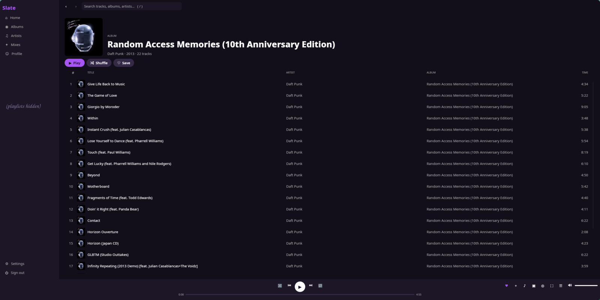

# Slate

A native desktop client for [TIDAL](https://tidal.com), written entirely in Rust with a
[Slint](https://slint.dev) UI. No webview, no Node.

> **Slate is a fork and port of [SONE](https://github.com/lullabyX/sone) by lullabyX.**
> The backend (TIDAL client, audio engine, scrobbling, proxy handling, MCP/OBS servers)
> comes from SONE; the Tauri + React frontend was replaced by a Slint UI and the logic
> that lived in the frontend (queue, shuffle/repeat, lyrics timing, themes) was ported to Rust.
> All credit for the original design and backend goes to lullabyX and SONE's contributors.
> Licensed under **GPL-3.0-only**, same as the original. Slate is **not affiliated with
> TIDAL**.

**What's new:** [CHANGELOG.md](CHANGELOG.md) · **For AI agents:** [docs-assets/MCP.md](docs-assets/MCP.md) ·
**Downloads:** Linux AppImage and Windows installer on the
[releases page](https://github.com/legendarylolo318-cloud/slate/releases).



*Album page. Personal playlist names are hidden in this screenshot.*

## Features

- Sign in with a device code + QR code; session kept in an encrypted config (AES-256-GCM,
  key in the OS keyring).
- Home, Explore (genres, moods, new releases), Search (tracks, artists, albums, playlists,
  videos), Library (Loved Tracks and Loved Videos, albums, artists, mixes, playlists and
  folders, each sortable), Album / Artist / Mix / Playlist pages.
- Lazy, virtualised track lists (thousands of tracks stay smooth) and a bounded
  thumbnail cache.
- Queue panel, shuffle (order restored when turned off), repeat, history, autoplay radio,
  queue persisted across restarts. Drag tracks onto sidebar playlists, reorder your own
  playlists and the queue by dragging, and drag playlists into folders.
- Playlist tools: remove duplicates, compare two playlists and merge them, smart playlists
  (rules on loved tracks, artist, quality, year, date added…, kept on your computer),
  suggested tracks under your own playlists, "Other versions…" (remaster, live, explicit /
  clean, Dolby Atmos) with replace in place, export to CSV / M3U and import from them.
- Ctrl+F filter and quality chips (Lossless / Hi-Res / Atmos) on playlist, album, Loved
  Tracks and mix pages; Go to album / artist from any track.
- Synced lyrics (click a line to seek), full-screen lyrics (`F11`) over a blurred cover, full-screen player, adaptive mini-player window,
  music-video playback (can shrink into the player bar).
- Audio: GStreamer engine, gapless playback, optional crossfade (off by default),
  ReplayGain normalisation, maximum-quality cap with automatic
  fallback, exclusive and bit-perfect output (ALSA with DAC detection on Linux, WASAPI exclusive
  on Windows), Signal Path
  panel with a PRISTINE / MODIFIED verdict.
- Scrobbling to Last.fm, Libre.fm and ListenBrainz; TIDAL play reporting (toggleable);
  Discord Rich Presence with your own text templates and per-playlist hiding.
- Listening party: listen together with friends, in sync, with emoji reactions (see below).
- Multi-select in track lists (Ctrl / Shift click, Ctrl+A), smarter shuffle (no same artist or album
  back to back, optional), a per-track lyrics timing nudge, "Like current track" from a global
  shortcut or the tray, and an optional LLM "DJ mixer" (see below).
- HTTP / HTTPS / SOCKS5 proxy with fail-closed behaviour.
- MCP server (`127.0.0.1:5577`) and OBS overlay (`127.0.0.1:5578`), both off by default. The
  MCP server has queue, search, playlist and context tools, an optional access token,
  read-only mode, in-app approval of destructive calls and an activity log with undo for AI
  agents: see [docs-assets/MCP.md](docs-assets/MCP.md).
- 15 theme presets plus your own themes (editor with contrast warnings, palette from the
  album cover, `.slatetheme` import / export), `theme.json` with live reload, interface scale.
- MPRIS and tray on Linux; media controls (SMTC), tray and sleep prevention on Windows (the
  Windows parts are built and tested in CI but have not been used on a real Windows desktop yet).
  Optional global shortcuts (Ctrl+Alt+Space / → / ←). Every shortcut can be rebound in
  Settings → Shortcuts; defaults: `Space` play/pause, `←/→` seek, `Ctrl+←/→` previous/next,
  `M` mute, `S` shuffle, `R` repeat, `Q` queue, `L` lyrics, `F` full screen, `/` search,
  `Ctrl+F` filter, `F11` full-screen lyrics, `Ctrl+Z` / `Ctrl+Shift+Z` queue undo / redo, `?` shortcut sheet.
- Personal tags (right-click → Tags…, a Tags page in the sidebar), queue undo / redo (`Ctrl+Z` /
  `Ctrl+Shift+Z`), and "Copy share card" / "Copy link" on any track.
- Settings search, keyboard focus rings and Tab navigation, tooltips on icon buttons.
- Single instance with `tidal://` and `slate://` links, profile editing, a daily update check
  against this repository's releases (can be turned off).

## Listening party

Settings → Party → Host gives you a `slate://party/…` link to copy. Friends open the
link (or paste it under Join) and their Slate follows yours: track, play / pause, seek and
the next few tracks. Guests can suggest tracks for you to approve. When you end the party you can save the tracks that
played as a playlist.

- **Everyone needs their own TIDAL subscription.** Only playback state is shared; each person
  streams from their own account. A track not available in a guest's region is skipped for
  that guest.
- **No ports to open.** Peers connect directly and encrypted (QUIC via
  [iroh](https://iroh.computer)), with hole punching and a relay fallback when a direct
  connection is not possible.
- **Custom relay:** set your own `iroh-relay` URL under Settings → Party if you prefer not to
  use the public relays.
- Up to 10 guests. Kicking a guest makes a new invite link. Nothing party-related runs until
  a party starts, and ending it closes everything. Builds without the `party` Cargo feature
  have no party at all.

Guests and the host can react to the current track with 👍 ❤️ 🔥 😂 🎉 👏 (shown next to the player;
the host sees the counts). If the host disappears, the co-host (or the guest who joined first) can take
the party over and the other guests follow to the new host without a new link.

## DJ mixer

Settings → Playback → DJ mixer (off by default). When your queue runs out, instead of dropping
straight to the radio, a chat model you configure picks the next genre, Slate searches TIDAL for
matching tracks and queues a block of them.

- **Bring your own model.** Any OpenAI-compatible `chat/completions` endpoint: OpenAI, OpenRouter,
  Ollama or something local. The titles and artists of the last 20 tracks are sent to it; nothing is
  sent while the DJ is off. Requests go through Slate's proxy settings.
- **Steer it.** The direction box takes plain words ("deeper into house"); "DJ up a block" asks for
  one now; "Test" checks the endpoint and says why it fails.
- **Fails soft.** Any error falls back to the usual radio, so the music does not stop.

Security, performance and feature-parity review results are in [REVIEW.md](REVIEW.md).

`slate --self-test --network` checks that GStreamer finds the plugins it needs and can
stream over HTTPS, then exits (useful for packaged builds). `slate --self-test --party-relay`
checks that the iroh relay a party would use (the default, or your custom one) is reachable.

## Phone remote (MPD)

Slate can speak the MPD protocol, so MPD clients (M.A.L.P. on Android, MaximumMPD and Rigelian on iPhone, `mpc` on a computer) can control it. It is off by default and no socket exists until you switch it on.

1. Settings → Integrations → **MPD server**: switch it on. It listens on `127.0.0.1:6600` (this computer only).
2. For a phone, switch on **Allow LAN**. Slate then listens on every network interface and generates a password; the settings page shows the password and your `IP:port`. **Copy** puts the password on the clipboard.
3. In the app, add a server: host = the IP shown, port = 6600, password = the one from Slate.
   - **iPhone** (MaximumMPD / Rigelian): Settings → add server, enter host, port and password, then pick it.
   - **Android** (M.A.L.P.): Settings → Profiles → add profile, same three fields.
4. Firewall: allow TCP 6600 from your local network.
   - ufw: `sudo ufw allow from 192.168.0.0/16 to any port 6600 proto tcp`
   - firewalld: `sudo firewall-cmd --add-port=6600/tcp` (add `--permanent` to keep it)
   - Windows: choose **Private networks** in the prompt Windows shows the first time.

Your TIDAL playlists appear as stored playlists, search uses TIDAL track search, and the MPD playlist is the playing track followed by the queue. Limits: 8 clients, 60 commands per 10 s each, idle connections close after 10 minutes.

**Warning:** anyone on the network who has the password can control playback. Use LAN mode on trusted networks only.

## Build

Requirements: a recent stable Rust toolchain and GStreamer 1.20+ (1.24+ for gapless).

### Arch Linux

```bash
sudo pacman -S --needed base-devel clang pkgconf rust gstreamer gst-plugins-base \
  gst-plugins-good gst-plugins-bad gst-libav alsa-lib dbus openssl fontconfig \
  libxkbcommon wayland libx11 vulkan-icd-loader
```

### Debian / Ubuntu

```bash
sudo apt install build-essential clang pkg-config libgstreamer1.0-dev \
  libgstreamer-plugins-base1.0-dev gstreamer1.0-plugins-good gstreamer1.0-plugins-bad \
  gstreamer1.0-libav libasound2-dev libdbus-1-dev libssl-dev libfontconfig1-dev \
  libxkbcommon-dev libwayland-dev libx11-dev libvulkan-dev
```

### Fedora

```bash
sudo dnf install gcc gcc-c++ clang pkgconf-pkg-config gstreamer1-devel \
  gstreamer1-plugins-base-devel gstreamer1-plugins-good gstreamer1-plugins-bad-free \
  gstreamer1-libav alsa-lib-devel dbus-devel openssl-devel fontconfig-devel \
  libxkbcommon-devel wayland-devel libX11-devel vulkan-loader-devel
```

### Windows

1. Install Rust with the **MSVC** toolchain (`rustup default stable-x86_64-pc-windows-msvc`)
   and the Visual Studio Build Tools (C++ workload).
2. Install the official GStreamer **MSVC 64-bit runtime and development** packages from
   <https://gstreamer.freedesktop.org/download/>, then set `GSTREAMER_1_0_ROOT_MSVC_X86_64`
   and add `%GSTREAMER_1_0_ROOT_MSVC_X86_64%\bin` to `PATH` and
   `%GSTREAMER_1_0_ROOT_MSVC_X86_64%\lib\pkgconfig` to `PKG_CONFIG_PATH` (pkg-config is required).
3. `cargo build --release`.

Release builds for Windows come from CI (`.github/workflows/release.yml`) as an installer
that also registers the `tidal://` and `slate://` links. ALSA-only options are hidden on
Windows; exclusive output uses WASAPI.

## Run

```bash
cargo run --release -p slate        # or ./target/release/slate
```

Settings and cache live in `~/.config/slate` (`%APPDATA%\slate` on Windows). Log level is
controlled with `SLATE_LOG` (default `info`), e.g. `SLATE_LOG=slate=debug,info`.

### Renderer

Slate tries Skia (Vulkan), then Skia (OpenGL), then FemtoVG, then the software renderer,
relaunching itself with the next one if a renderer fails to start, and logs the one in use.
Force one with Slint's variable, e.g. `SLINT_BACKEND=winit-femtovg` or
`SLINT_BACKEND=winit-software`. Cargo features: `renderer-skia-vulkan`, `renderer-femtovg`,
`renderer-software` and `party` (all on by default).

## Development

```bash
cargo fmt --all
cargo clippy --workspace --all-targets -- -D warnings
cargo test --workspace
```

Layout: `crates/slate-core` (all non-UI logic, no Slint) and `crates/slate-app` (Slint UI and
platform glue). See [HANDOFF.md](HANDOFF.md) for the architecture and threading model.
