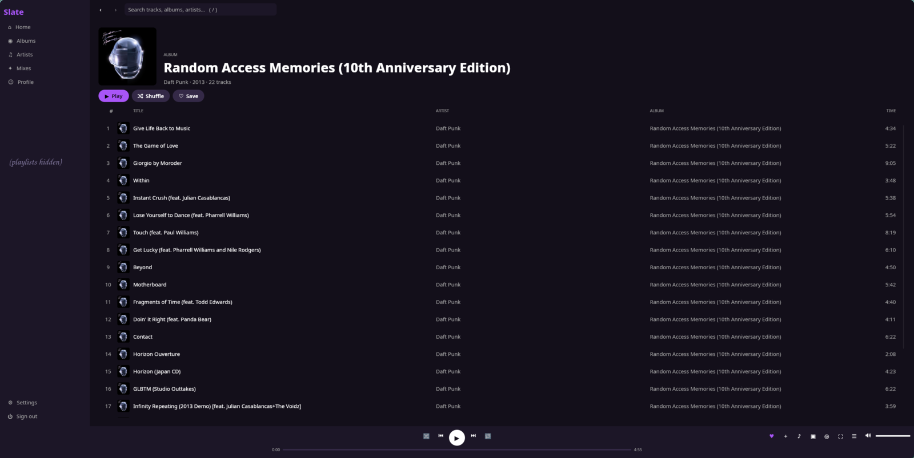

# Slate

A native desktop client for [TIDAL](https://tidal.com), written entirely in Rust with a
[Slint](https://slint.dev) UI. No webview, no Node.

> **Slate is a fork and port of [SONE](https://github.com/lullabyX/sone) by lullabyX.**
> The backend (TIDAL client, audio engine, scrobbling, proxy handling, MCP/OBS servers)
> comes from SONE; the Tauri + React frontend was replaced by a Slint UI and the logic
> that lived in the frontend (queue, shuffle/repeat, lyrics timing, themes) was ported to Rust.
> All credit for the original design and backend goes to lullabyX and SONE's contributors.
> Licensed under **GPL-3.0-only**, same as the original. Slate is **not affiliated with
> TIDAL**.

> **Status: work in progress.** See [PORTING_PLAN.md](PORTING_PLAN.md) for what is done,
> and [HANDOFF.md](HANDOFF.md) for known issues and what has not been tested.



*Album page. Personal playlist names are hidden in this screenshot.*

## Features

- Sign in with a device code + QR code; session kept in an encrypted config (AES-256-GCM,
  key in the OS keyring).
- Home, Search (tracks, artists, albums, playlists, videos), Library (Loved Tracks, albums,
  artists, mixes, playlists and folders), Album / Artist / Mix / Playlist pages.
- Lazy, virtualised track lists (thousands of tracks stay smooth) and a bounded
  thumbnail cache.
- Queue panel, shuffle (order restored when turned off), repeat, history, autoplay radio,
  queue persisted across restarts.
- Synced lyrics (click a line to seek), full-screen player, adaptive mini-player window,
  music-video playback.
- Audio: GStreamer engine, ReplayGain normalisation, maximum-quality cap with automatic
  fallback, exclusive and bit-perfect ALSA output with DAC detection (Linux), Signal Path
  panel with a PRISTINE / MODIFIED verdict.
- Scrobbling to Last.fm, Libre.fm and ListenBrainz; TIDAL play reporting (toggleable);
  Discord Rich Presence.
- HTTP / HTTPS / SOCKS5 proxy with fail-closed behaviour.
- MCP server (`127.0.0.1:5577`) and OBS overlay (`127.0.0.1:5578`), both off by default.
- 15 theme presets, custom colours with a built-in picker, `theme.json` with live reload,
  interface scale setting.
- MPRIS and tray on Linux. Keyboard shortcuts: `Space` play/pause, `←/→` seek, `Ctrl+←/→`
  previous/next, `M` mute, `S` shuffle, `R` repeat, `Q` queue, `L` lyrics, `F` full screen,
  `/` search.

- Gapless playback, single-instance with `tidal://` links, profile editing.

Not yet done (see the plan): Windows media controls and tray, Explore sub-pages,
shortcut overlay, global shortcuts.

## Build

Requirements: a recent stable Rust toolchain and GStreamer 1.20+ (1.24+ for gapless).

### Arch Linux

```bash
sudo pacman -S --needed base-devel clang pkgconf rust gstreamer gst-plugins-base \
  gst-plugins-good gst-plugins-bad gst-libav alsa-lib dbus openssl fontconfig \
  libxkbcommon wayland libx11 vulkan-icd-loader
```

### Debian / Ubuntu

```bash
sudo apt install build-essential clang pkg-config libgstreamer1.0-dev \
  libgstreamer-plugins-base1.0-dev gstreamer1.0-plugins-good gstreamer1.0-plugins-bad \
  gstreamer1.0-libav libasound2-dev libdbus-1-dev libssl-dev libfontconfig1-dev \
  libxkbcommon-dev libwayland-dev libx11-dev libvulkan-dev
```

### Fedora

```bash
sudo dnf install gcc gcc-c++ clang pkgconf-pkg-config gstreamer1-devel \
  gstreamer1-plugins-base-devel gstreamer1-plugins-good gstreamer1-plugins-bad-free \
  gstreamer1-libav alsa-lib-devel dbus-devel openssl-devel fontconfig-devel \
  libxkbcommon-devel wayland-devel libX11-devel vulkan-loader-devel
```

### Windows

1. Install Rust with the **MSVC** toolchain (`rustup default stable-x86_64-pc-windows-msvc`)
   and the Visual Studio Build Tools (C++ workload).
2. Install the official GStreamer **MSVC 64-bit runtime and development** packages from
   <https://gstreamer.freedesktop.org/download/>, then set `GSTREAMER_1_0_ROOT_MSVC_X86_64`
   and add `%GSTREAMER_1_0_ROOT_MSVC_X86_64%\bin` to `PATH` and
   `%GSTREAMER_1_0_ROOT_MSVC_X86_64%\lib\pkgconfig` to `PKG_CONFIG_PATH` (pkg-config is required).
3. `cargo build --release`.

> The Windows build has **not been verified** yet; ALSA-only options are hidden there and
> media controls / tray are not implemented on Windows.

## Run

```bash
cargo run --release -p slate        # or ./target/release/slate
```

Settings and cache live in `~/.config/slate` (`%APPDATA%\slate` on Windows). Log level is
controlled with `SLATE_LOG` (default `info`), e.g. `SLATE_LOG=slate=debug,info`.

### Renderer

Slate tries Skia (Vulkan), then Skia (OpenGL), then FemtoVG, then the software renderer,
relaunching itself with the next one if a renderer fails to start, and logs the one in use.
Force one with Slint's variable, e.g. `SLINT_BACKEND=winit-femtovg` or
`SLINT_BACKEND=winit-software`. Cargo features: `renderer-skia-vulkan` (default),
`renderer-femtovg`, `renderer-software`.

## Development

```bash
cargo fmt --all
cargo clippy --workspace --all-targets -- -D warnings
cargo test --workspace
```

Layout: `crates/slate-core` (all non-UI logic, no Slint) and `crates/slate-app` (Slint UI and
platform glue). See [HANDOFF.md](HANDOFF.md) for the architecture and threading model.
